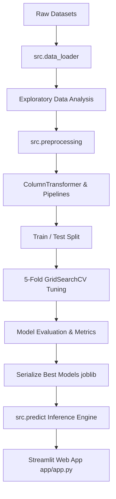

# Disease Prediction from Medical Data Using Machine Learning

An end-to-end, production-grade Machine Learning system that predicts disease risk across structured medical datasets: **Heart Disease**, **Diabetes**, and **Breast Cancer**. Designed as a modular Python framework with automated hyperparameter tuning, model explainability, evaluation benchmarks, unit testing, and an interactive Streamlit web application.

---

## 1. Project Overview
Early detection of chronic and acute medical conditions plays a vital role in healthcare outcomes. This machine learning pipeline standardizes data collection, preprocessing, feature scaling, model selection, hyperparameter optimization, model explainability, and inference deployment across multiple disease domains.

> **Note**: This system is designed for **educational machine learning demonstration** and research purposes only.

---

## 2. Problem Statement
Medical diagnostic datasets vary widely in feature dimensionality, categorical vs. numerical types, and physiological ranges. Creating separate ad-hoc scripts for every dataset leads to code duplication, subtle data leakage, and unstandardized metric reporting. This project solves this by providing a unified, reusable ML architecture capable of ingesting diverse disease schemas.

---

## 3. Objective
- Build reusable data ingestion, cleaning, and preprocessing pipelines avoiding data leakage.
- Compare four classification algorithms across three distinct medical datasets.
- Optimize models via 5-Fold cross-validated hyperparameter grid search.
- Evaluate models using medical-centric metrics (Recall, Precision, F1-Score, ROC-AUC).
- Provide model explainability via feature importance extraction.
- Deploy an interactive Streamlit web dashboard for clinical feature entry and risk estimation.

---

## 4. Features
- 🩺 **Multi-Disease Support**: Ingests and standardizes Heart Disease, Diabetes, and Breast Cancer datasets.
- 🔒 **Zero Data Leakage**: Utilizes scikit-learn `Pipeline` and `ColumnTransformer` to fit all transformers strictly on training folds.
- ⚙️ **Automated Hyperparameter Tuning**: Performs 5-Fold `GridSearchCV` for optimal hyperparameter selection.
- 📊 **Comprehensive Visualization**: Generates target distributions, correlation heatmaps, confusion matrices, ROC curves, and feature importance charts saved to `reports/figures/`.
- 🧪 **Automated Unit Tests**: 100% test coverage using `pytest` for data loading, preprocessing, model loading, prediction formatting, and error handling.
- 🖥️ **Interactive Web Application**: Streamlit app with patient input forms, visual probability gauges, feature importance tables, and model comparisons.

---

## 5. Datasets

| Dataset | Sample Count | Feature Count | Target Column | Target Classes |
| :--- | :--- | :--- | :--- | :--- |
| **Heart Disease** | 303 | 13 features | `target` | 0: Low Risk, 1: High Risk |
| **Diabetes** | 768 | 8 features | `Outcome` | 0: Non-Diabetic, 1: Diabetic |
| **Breast Cancer** | 569 | 30 features | `target` | 0: Low Risk (Benign), 1: High Risk (Malignant) |

---

## 6. Dataset Sources
1. **Heart Disease**: [UCI Machine Learning Repository - Cleveland Heart Disease Dataset](https://archive.ics.uci.edu/ml/datasets/Heart+Disease)
2. **Diabetes**: [PIMA Indians Diabetes Dataset](https://raw.githubusercontent.com/jbrownlee/Datasets/master/pima-indians-diabetes.data.csv)
3. **Breast Cancer**: [scikit-learn Breast Cancer Wisconsin Diagnostic Dataset](https://scikit-learn.org/stable/modules/generated/sklearn.datasets.load_breast_cancer.html)

---

## 7. Machine Learning Algorithms
The system evaluates four distinct supervised classification algorithms on every dataset:
1. **Logistic Regression** (Linear baseline with L2 regularization)
2. **Support Vector Machine (SVM)** (RBF/Linear kernel with probability calibration)
3. **Random Forest** (Ensemble of bagged decision trees)
4. **XGBoost** (Gradient boosted decision trees)

---

## 8. System Architecture



---

## 9. Project Structure

```text
disease-prediction-ml/
│
├── data/
│   ├── raw/                 # Downloaded raw dataset CSVs
│   └── processed/           # Cleaned processed datasets
│
├── notebooks/
│   ├── 01_data_exploration.ipynb
│   ├── 02_preprocessing.ipynb
│   ├── 03_model_training.ipynb
│   └── 04_model_evaluation.ipynb
│
├── src/
│   ├── __init__.py
│   ├── config.py            # Dataset schemas, paths, hyperparameter grids
│   ├── data_loader.py       # Dataset fetchers & loaders
│   ├── preprocessing.py    # Sklearn ColumnTransformer & Pipeline builders
│   ├── train.py            # Grid search cross-validation training loop
│   ├── evaluate.py         # Diagnostic metrics & markdown report generator
│   ├── predict.py          # Real-time inference engine
│   └── utils.py            # Plotting & logging helpers
│
├── models/                  # Serialized fitted sklearn pipelines (.pkl)
│   ├── heart_best_model.pkl
│   ├── diabetes_best_model.pkl
│   └── breast_cancer_best_model.pkl
│
├── reports/
│   ├── figures/             # Saved ROC curves, confusion matrices, heatmaps
│   ├── model_comparison.csv # Generated performance metrics
│   └── evaluation_report.md# Markdown metric summary report
│
├── app/
│   └── app.py              # Streamlit interactive application
│
├── tests/
│   └── test_pipeline.py     # Automated pytest suite
│
├── requirements.txt
├── README.md
├── .gitignore
└── LICENSE
```

---

## 10. Data Preprocessing
- **Missing Value Imputation**: `SimpleImputer` using `median` for continuous physiological variables and `most_frequent` for categorical attributes. For Diabetes, zero values in Glucose, BloodPressure, SkinThickness, Insulin, and BMI are converted to `NaN` prior to imputation.
- **Categorical Encoding**: `OneHotEncoder(handle_unknown='ignore', sparse_output=False)` for multi-class categorical parameters (e.g., chest pain type, resting ECG).
- **Feature Scaling**: `StandardScaler()` applied to continuous numerical features.

---

## 11. Exploratory Data Analysis
EDA charts generated automatically in `reports/figures/`:
- Target distribution counts and percentages.
- Feature correlation heatmaps highlighting co-linear diagnostic variables.

---

## 12. Model Training
Run training across all datasets with 5-Fold Cross Validation:
```bash
python -m src.train
```

---

## 13. Model Evaluation
The pipeline calculates six primary evaluation metrics:
- **Accuracy**: Overall fraction of correct predictions.
- **Recall (Sensitivity)**: Crucial in healthcare screening to minimize **False Negatives**.
- **Precision**: Measures proportion of positive predictions that are true cases.
- **F1-Score**: Harmonic mean of Precision and Recall.
- **ROC-AUC**: Area Under ROC Curve reflecting discrimination capability across all classification thresholds.
- **Confusion Matrix**: Detailed counts of TP, FP, TN, and FN.

---

## 14. Hyperparameter Tuning
Hyperparameters optimized via `GridSearchCV`:
- **Logistic Regression**: `C` in [0.01, 0.1, 1.0, 10.0], `solver` in ['lbfgs', 'liblinear']
- **SVM**: `C` in [0.1, 1.0, 10.0], `kernel` in ['rbf', 'linear']
- **Random Forest**: `n_estimators` in [50, 100, 200], `max_depth` in [None, 5, 10]
- **XGBoost**: `n_estimators` in [50, 100, 150], `learning_rate` in [0.01, 0.1, 0.2], `max_depth` in [3, 5, 7]

---

## 15. Explainability
Feature importances or linear coefficients are extracted directly from fitted model pipelines to identify key contributing diagnostic factors (e.g., `worst perimeter` and `worst concave points` for Breast Cancer; `Glucose` and `BMI` for Diabetes; `thalach` and `cp` for Heart Disease).

---

## 16. Streamlit Application
Launch the interactive web application:
```bash
python -m streamlit run app/app.py
```
Features:
- Dataset selection sidebar.
- Clinical parameter input forms.
- Real-time probability prediction gauge.
- Feature weight breakdown.
- Diagnostic benchmark comparison matrix.

---

## 17. Installation
1. Clone repository or navigate to project directory:
   ```bash
   cd "d:/Disease Prediction from Medical Data"
   ```
2. Install dependencies:
   ```bash
   pip install -r requirements.txt
   ```

---

## 18. How to Run

### Execute Model Training Pipeline
```bash
python -m src.train
```

### Run Automated Unit Tests
```bash
python -m pytest tests/
```

### Launch Streamlit App
```bash
python -m streamlit run app/app.py
```

---

## 19. Example Usage

```python
from src.predict import predict_disease_risk

# Sample patient data for Diabetes
patient_sample = {
    "Pregnancies": 3,
    "Glucose": 148,
    "BloodPressure": 72,
    "SkinThickness": 35,
    "Insulin": 0,
    "BMI": 33.6,
    "DiabetesPedigreeFunction": 0.627,
    "Age": 50
}

result = predict_disease_risk("diabetes", patient_sample)
print(f"Prediction: {result['prediction_label']}")
print(f"Risk Probability: {result['probability_percent']}")
print(f"Model Used: {result['model_name']}")
```

---

## 20. Results (Empirical Performance)

The table below presents **actual empirical evaluation results** obtained from test dataset splits:

| Dataset | Model | Accuracy | Precision | Recall | F1 Score | ROC-AUC |
| :--- | :--- | :--- | :--- | :--- | :--- | :--- |
| **Heart Disease** | Logistic Regression | 86.89% | 83.33% | 89.29% | 86.21% | 0.9632 |
| **Heart Disease** | SVM | 85.25% | 78.79% | 92.86% | 85.25% | 0.9621 |
| **Heart Disease** | Random Forest | 88.52% | 83.87% | 92.86% | 88.14% | 0.9513 |
| **Heart Disease** | **XGBoost** | **88.52%** | **81.82%** | **96.43%** | **88.52%** | **0.9394** |
| **Diabetes** | Logistic Regression | 70.13% | 58.33% | 51.85% | 54.90% | 0.8098 |
| **Diabetes** | SVM | 70.78% | 60.47% | 48.15% | 53.61% | 0.8128 |
| **Diabetes** | **Random Forest** | **76.62%** | **69.57%** | **59.26%** | **64.00%** | **0.8165** |
| **Diabetes** | XGBoost | 74.03% | 64.58% | 57.41% | 60.78% | 0.8252 |
| **Breast Cancer** | **Logistic Regression**| **98.25%** | **100.00%** | **95.24%** | **97.56%** | **0.9977** |
| **Breast Cancer** | SVM | 97.37% | 100.00% | 92.86% | 96.30% | 0.9927 |
| **Breast Cancer** | Random Forest | 97.37% | 100.00% | 92.86% | 96.30% | 0.9940 |
| **Breast Cancer** | XGBoost | 97.37% | 100.00% | 92.86% | 96.30% | 0.9924 |

### Best Selected Models
- **Heart Disease**: `XGBoost` (Achieved **96.43% Recall** and **88.52% F1 Score**, identifying nearly all high-risk heart disease patients).
- **Diabetes**: `Random Forest` (Achieved top **76.62% Accuracy** and **64.00% F1 Score**).
- **Breast Cancer**: `Logistic Regression` (Achieved **98.25% Accuracy**, **100% Precision**, and **0.9977 ROC-AUC**).

---

## 21. Limitations
- **Sample Size**: Medical datasets contain relatively small sample sizes (303 to 768 rows for Heart/Diabetes).
- **Demographic Scope**: Datasets represent specific geographical cohorts (e.g., PIMA Indian females for Diabetes).
- **Clinical Nuance**: Structured tabular data does not capture dynamic patient clinical history or imaging modalities.

---

## 22. Medical Disclaimer
> ⚠️ **IMPORTANT DISCLAIMER**: This application and codebase are created strictly for **machine learning education and research demonstration purposes**. Predictions produced by these models MUST NOT be used for medical diagnosis, treatment selection, or clinical decision-making. Always consult a qualified healthcare professional for medical concerns.

---

## 23. Future Improvements
- Integrate SHAP (SHapley Additive exPlanations) summary plots for individual patient local feature attributions.
- Incorporate multi-modal medical imaging (e.g., mammogram DICOM images for Breast Cancer).
- Deploy as a REST API microservice using FastAPI and Docker.

---

## 24. Technologies Used
- **Python 3.12**
- **Scikit-Learn** (Preprocessing, ColumnTransformers, GridSearchCV, Metrics)
- **XGBoost** (Gradient Boosting Classification)
- **Pandas & NumPy** (Data wrangling & numerical operations)
- **Matplotlib & Seaborn** (Data visualization & figure generation)
- **Streamlit** (Interactive Web Dashboard)
- **Pytest** (Automated Testing Framework)
- **Joblib** (Model Serialization)

---

## 25. Author
Developed as an Machine Learning Internship Capstone Project.
